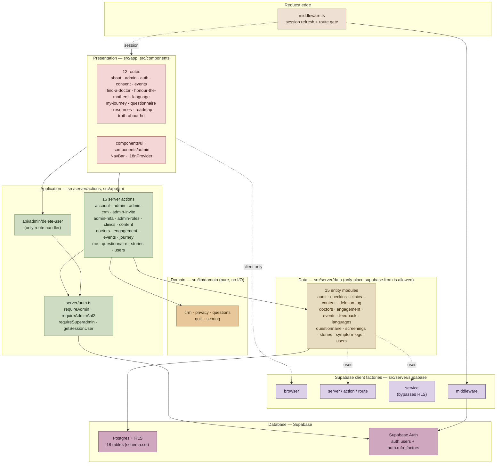
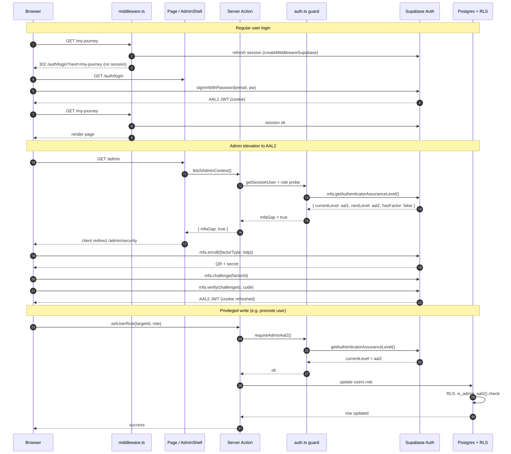
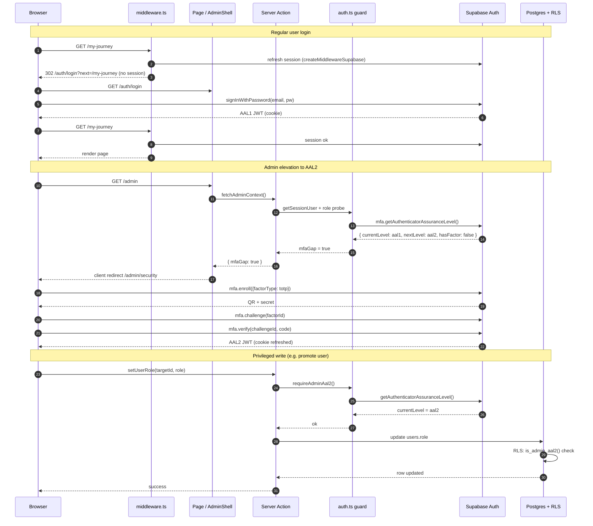
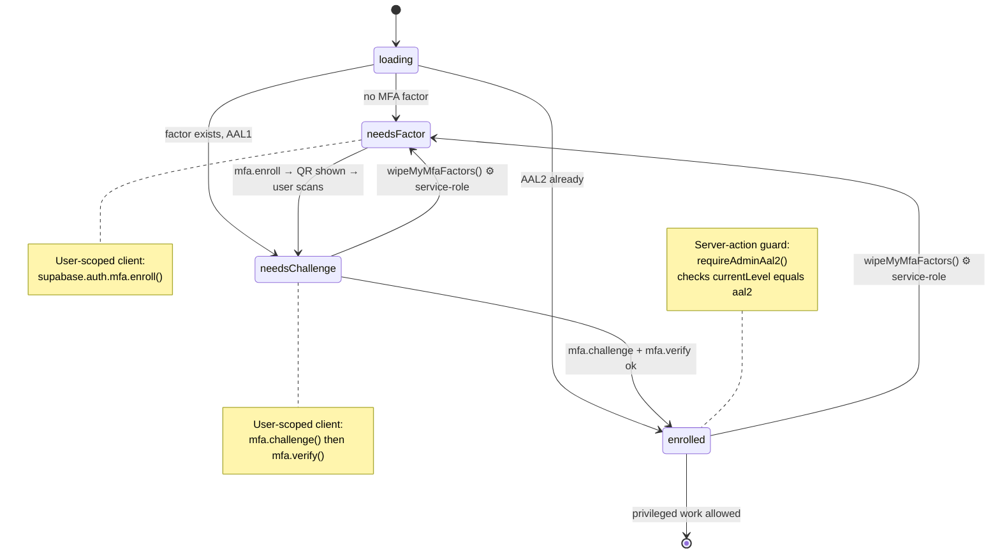
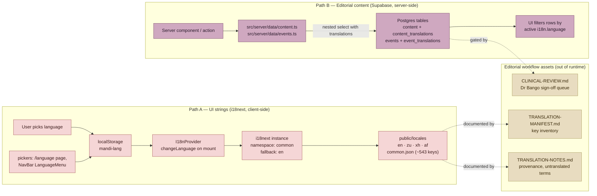

# JoinMandi — System Architecture

A reference for engineers working in this repo. Four focused Mermaid diagrams
cover the layered stack, the auth + MFA flow, the admin MFA state machine, and
the dual-path translation system. Each diagram is followed by a short caption
linking into the source.

The canonical rules (the "what may call what" dependency rule, where
`supabase.from()` is allowed, etc.) live in [CLAUDE.md](../CLAUDE.md). This
document shows the **shape** — boxes, arrows, and the security boundaries.

**Out of scope today** (so you don't go hunting):

- No external integrations — no email/SMS provider, no payments, no analytics
  SDK, no maps, no file storage beyond Supabase. Supabase Auth sends its own
  confirmation emails.
- No background workers, cron jobs, or queues. Every flow is request →
  response.
- The editorial **authoring** workflow (who writes the JSON, how Dr Bango's
  clinical review is tracked) is a process question, not architecture — see
  [public/locales/TRANSLATION-NOTES.md](../public/locales/TRANSLATION-NOTES.md)
  and [public/locales/CLINICAL-REVIEW.md](../public/locales/CLINICAL-REVIEW.md).

---

## 1. Layered system overview

The stack obeys a strict downward dependency rule: Presentation → Application
→ Domain → Data → Database. No sideways calls inside a layer, no upward calls.
The middleware sits at the request edge; the Supabase client factories are a
side-rail used by data-layer modules and the middleware.

Mermaid source (edit me)

**Read the layers in the code:** routes in [src/app/](../src/app),
shared components in [src/components/](../src/components), server actions in
[src/server/actions/](../src/server/actions), guards in
[src/server/auth.ts](../src/server/auth.ts), pure logic in
[src/lib/domain/](../src/lib/domain), data access in
[src/server/data/](../src/server/data), schema in
[supabase/schema.sql](../supabase/schema.sql).

> **Where do I add a new admin action that requires MFA?** Add the function to
> a file under [src/server/actions/](../src/server/actions); call
> `await requireAdminAal2()` (or `requireSuperadmin()`) from
> [src/server/auth.ts](../src/server/auth.ts) at the top; do all writes through
> a [src/server/data/](../src/server/data) module — never `supabase.from()`
> from the action directly.

---

## 2. Auth + MFA flow

Three sequential gates protect privileged operations: the **edge middleware**,
the **server-action guard**, and the **RLS policy** in Postgres. All three must
agree before a write lands. The diagram shows a regular user landing on
`/my-journey` then an admin elevating to AAL2 to access `/admin/security`.

Mermaid source (edit me)

**Key entry points:**
[src/middleware.ts](../src/middleware.ts) (session refresh + route gate),
[src/app/auth/login/page.tsx](../src/app/auth/login/page.tsx) (`signInWithPassword`),
[src/components/admin/AdminShell.tsx](../src/components/admin/AdminShell.tsx)
(reads `fetchAdminContext`, redirects on `mfaGap`),
[src/app/admin/security/page.tsx](../src/app/admin/security/page.tsx) (TOTP
enroll → challenge → verify),
[src/server/auth.ts](../src/server/auth.ts)
(`requireAdmin`, `requireAdminAal2`, `requireSuperadmin`),
[supabase/schema.sql](../supabase/schema.sql) (`is_admin_aal2()` and
`is_superadmin_aal2()` SQL helpers that policies call).

**Defense-in-depth:** if the middleware misses a route, the server-action guard
still blocks. If the guard is forgotten, RLS still blocks. If RLS is wrong, the
service-role client is the only escape — and that client lives in one file
([src/server/supabase/service.ts](../src/server/supabase/service.ts)) you can
audit by hand.

---

## 3. Admin MFA state machine

The admin's MFA status, as the client sees it on `/admin/security`. The "wipe
stuck factors" transition is the escape hatch when an unverified enrolment gets
orphaned — it is the only state change that needs the service-role client.

Mermaid source (edit me)

**Source:**
[src/app/admin/security/page.tsx](../src/app/admin/security/page.tsx) owns the
client state machine and stages (`loading`, `needsFactor`, `needsChallenge`,
`enrolled`).
[src/server/actions/admin-mfa.ts](../src/server/actions/admin-mfa.ts)
exposes `listMyMfaFactors()` and `wipeMyMfaFactors()` — the latter uses
[src/server/supabase/service.ts](../src/server/supabase/service.ts) to clear
orphaned factors via the Supabase Auth admin API.

---

## 4. Translation dual-path

Two pipelines, on purpose. **UI strings** (button labels, helper text, error
messages) live in JSON, ship with the bundle, and switch client-side via
i18next. **Editorial content** (articles, events) lives in Postgres with one
canonical row plus a `*_translations` child per language, and is fetched
server-side. Don't mix them.

Mermaid source (edit me)

**Asymmetry to know about:** only `content` and `events` use the canonical-plus-
`*_translations`-child pattern. `clinic_directory`, `doctor_profiles`, and
`stories` store language metadata inline (a `languages[]` array or a single
`language_code` field) rather than full per-language rows. If you add a new
editorial table where every language needs distinct copy, follow the
content/events pattern; if every clinic just has *one* language tag, follow the
clinics pattern.

**Source pointers:**
[src/lib/i18n.ts](../src/lib/i18n.ts) (i18next config, supported locales,
fallback chain),
[src/components/I18nProvider.tsx](../src/components/I18nProvider.tsx)
(post-mount language restore, tree re-key on change),
[src/app/language/page.tsx](../src/app/language/page.tsx) and
[src/components/ui/LanguageMenu.tsx](../src/components/ui/LanguageMenu.tsx)
(pickers),
[public/locales/en/common.json](../public/locales/en/common.json) (UI strings),
[src/server/data/content.ts](../src/server/data/content.ts) and
[src/server/data/events.ts](../src/server/data/events.ts) (joined fetches),
[supabase/schema.sql](../supabase/schema.sql) (`content_translations`,
`event_translations` tables).

> **Where do I add a new translatable editorial table?** Define the canonical
> table + a `*_translations` child with `(parent_id, language_code)` unique in
> [supabase/schema.sql](../supabase/schema.sql); add an entity module under
> [src/server/data/](../src/server/data) that selects
> `*, *_translations(*)`; expose mutations through a new
> [src/server/actions/](../src/server/actions) file. UI strings for the new
> feature go in
> [public/locales/{en,zu,xh,af}/common.json](../public/locales/en/common.json)
> and are surfaced by `useTranslation('common')`.
