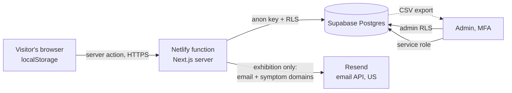

# Mandi-Platform — Data flow map (POPIA)

**Date:** 2026-08-22 · **Audience:** Legal / POPIA sign-off, Dr Bango, engineering.
Companion to `SECURITY-AUDIT.md` (controls) — this document is about *where data lives, moves, and is kept*.

Symptom and health answers are **special personal information** under POPIA s26. Contact details (email, WhatsApp) are personal information. This map lists every place either is stored, every hop it makes, and the open items Legal must decide.

## 1. Flow at a glance

Hops: browser → Netlify (functions run the server actions) → Supabase. The only outbound third-party flow is Resend, and only for exhibition signups.

## 2. Inventory — tables holding special PI or PII

| Table | What it holds | Class | Owner link | Who can read (RLS) |
|---|---|---|---|---|
| `questionnaire_responses` | `answers` jsonb (56 answers), `meno_score`, `score_band`, `persona`, `self_harm_flag`, `colleen_flag`, `top_domains` | **Special PI** | `user_id` (null for anonymous), `session_id` | Own row (`user_id = auth.uid()`); admins. Anonymous rows: **admins only** (fixed 2026-08-22, see §6) |
| `symptom_logs` | daily domain score 0–3 per user | **Special PI** | `user_id` | Own row only |
| `checkins` | 6-week / 3-month check-in answers, free text | **Special PI** | `user_id` | Own row only |
| `clinical_screenings` | clinician-entered answers, score, risk band, notes; `patient_reference` (no patient PII by rule) | **Special PI (clinical)** | `clinician_id` | Own clinician; admins |
| `stories` | free-text story, `author_name`, symptom tags | Health narrative + PII | `user_id`/`session_id` (nullable) | Public if `status = 'approved'`; admins |
| `exhibition_signups` | `email`, `whatsapp`, `age_band`, `meno_score`, `score_band`, `answers` (8 curated for `source='exhibition'`, full set for `source='roadmap'`), `consent`, `marketing_opt_in` | **Special PI + PII** | none (email only) | Admins only. Erased by email on user deletion (§5) |
| `users` | `email`, `language_code`, `role` | PII | `id = auth.users.id` | Own row; admins |
| `sessions` | `language_code`, `popia_consent`, `popia_consent_at` | Consent record | anonymous id | World-readable (holds no PI) |
| `engagement_events` | `event_type`, `target_id` (path / domain / doctor id), `session_id`, `user_id`, `meta` (lang, score_band, persona, format, province, source) | Behavioural, pseudonymous | `session_id` / `user_id` | Admins only |
| `popia_deletion_log` | `user_email`, `deleted_at`, `deleted_by` | PII (retained by design) | — | Admins only |
| `admin_audit_log` | `actor_email`, `action`, `target_id`, `meta.target_email` | PII | — | Superadmin + MFA |

Tables with no personal data: `languages`, `content`, `content_translations`, `events`, `event_translations`, `clinic_directory`, `doctor_profiles` (published business/professional data), `roadmap_feedback` (unused).

## 3. Client-side residency (the visitor's own device)

| `localStorage` key | Contents | Set at | Cleared |
|---|---|---|---|
| `mandi-questionnaire-progress` | in-progress answers + index | every answer | on completion |
| `mandi-answers` | full 56-answer set | completion | never (roadmap reads it) |
| `mandi-score` | score, band, persona, flags, top domains | completion | never |
| `mandi-session` | POPIA session id | consent | never |
| `mandi-consent` | consent timestamp | consent | never |
| `mandi-kept` | timestamp of "keep my blanket" | roadmap signup | never |
| `mandi-lang` | language | language choice | never |

The roadmap renders from `mandi-score` / `mandi-answers`, not from the database. No cookies are set by the app; Supabase auth cookies exist only for signed-in users. No third-party scripts or pixels run on the site (CSP `script-src 'self'`).

**Open item:** health answers persist on a shared device indefinitely. A "clear my blanket from this device" control is a small addition if Legal wants it.

## 4. Processors and transfers

| Processor | Role | Data | Region | Status |
|---|---|---|---|---|
| Netlify | hosting + server functions | everything in transit | function region not pinned in `netlify.toml` | **Open:** confirm region; DPA |
| Supabase | database, auth | all tables above | **Open:** read the project region from the Supabase dashboard | **Open:** DPA; s72 cross-border if outside SA |
| Resend | transactional email (exhibition results) | recipient email + the symptom *domains* she reported (not scores, not answers) | US | **Open:** DPA; currently not configured (`RESEND_API_KEY` unset), so no data flows today |

Env vars involved: `NEXT_PUBLIC_SUPABASE_URL`, `NEXT_PUBLIC_SUPABASE_ANON_KEY`, `SUPABASE_SERVICE_ROLE_KEY` (server only), `RESEND_API_KEY`, `RESEND_FROM`.

## 5. Retention and deletion

- **Signed-in user deletion** (`POST /api/admin/delete-user`, admin + MFA): hard-deletes `auth.users`; cascades to `users`, `questionnaire_responses`, `checkins`, `symptom_logs`, `clinical_screenings`. `stories`, `engagement_events`, `admin_audit_log` keep their rows with `user_id` set null. **As of 2026-08-22 also deletes `exhibition_signups` rows by email.** Logged to `popia_deletion_log` + `admin_audit_log`.
- **Anonymous questionnaire rows** have no owner and cannot be tied back to a person; they are readable by admins only.
- **Retention periods are not yet defined** for any table. **Open item for Legal.**
- **No self-service erasure**: data subjects email `info@joinmandi.com`; an admin performs the deletion.

## 6. Changes made on 2026-08-22

1. `qr_select_own` no longer includes `or user_id is null` — anonymous health rows were readable with the public anon key.
2. `exhibition_signups` rows are erased by email during user deletion.
3. First-party analytics added (`page_view`, `questionnaire_start/domain/complete`, `keep_submit`) — pseudonymous, no PII in `target_id` or `meta`, no cookies.
4. Post-score "keep my blanket" capture on `/roadmap` writes to `exhibition_signups` with `source = 'roadmap'`; consent is an explicit checkbox, marketing opt-in is a separate unticked checkbox.

## 7. Open items for Legal / POPIA

1. Supabase project region and Netlify function region → cross-border transfer status (s72).
2. DPAs with Supabase, Netlify, Resend.
3. Retention periods per table (especially anonymous `questionnaire_responses`, `exhibition_signups`, `engagement_events`).
4. Privacy policy page (required by the brief; `footer.privacy` key exists, page does not).
5. Self-service erasure and "clear this device" control — nice-to-have.
6. Information Officer registration and the consent wording in `consent.*` / `roadmap.keep.consent` (Dr Bango + Legal review).
